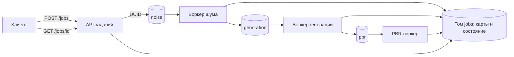

# НИР · Генерация текстур

| Модуль | Назначение | Доступно |
|---|---|---|
| [noise](src/texgen/noise/README.md) | Периодические карты высот | Python API и CLI |
| [generation](src/texgen/generation/README.md) | Генерация albedo и апскейл | HTTP API |
| [pbr](src/texgen/pbr/README.md) | Расчёт карт материала | HTTP API |

## Локальный запуск

Команды для PowerShell выполняйте из `06_НИР`. Для ядра и тестов используйте `requirements.txt`, для ноутбуков — `notebooks/requirements.txt`.

```powershell
python -m pip install -r requirements.txt
$env:PYTHONPATH = (Resolve-Path src).Path
python -m unittest discover -s tests -v
```

## Подготовка ambientCG

Сохраните каталог материалов в `data/catalog.csv` в UTF-8. Одна строка соответствует одной карте Color.

```csv
material_id,group_id,category,license,source_url,color,caption
```

- В `color` укажите путь относительно CSV к квадратной карте Color в режиме RGB или L от 512×512. При импорте метаданных зеркала сопоставьте записи с файлами Color и исключите HDRI, декали и рендеры.
- В `source_url` укажите `https://ambientcg.com/view?id=<material_id>`, в `caption` — проверенную английскую подпись. В выборку входят строки с `license=CC0`.
- Вариантам одной поверхности назначьте общий `group_id` и одну категорию. После отбора в каждой категории должно остаться хотя бы три группы.

```powershell
python -m texgen.dataset data/catalog.csv data/ambientcg-512 --limit 400 --seed 42
```

Для этой команды нужны минимум 400 подходящих материалов и новый выходной каталог. При точном совпадении RGB-данных скрипт сообщит ID обеих карт и остановится.

В `train/`, `validation/` и `test/` сохраняются плитки 512×512. Группы распределяются целиком внутри каждой категории, поэтому доли материалов могут отличаться от 80/10/10. В `manifest.jsonl` записаны разбиение, пути к плиткам, подписи, источники и SHA-256 пикселей исходной карты после приведения к RGB. Для карт L яркость копируется во все три канала. Поле `source_mode` хранит исходный режим. Признак `nearly_uniform_luma` равен `true`, когда 1-й и 99-й процентили яркости исходника совпадают. Такие плитки остаются в выборке.

## Проверка стыков в Kaggle

[Ноутбук проверки шума](notebooks/01_noise.ipynb) показывает карты и повтор 2×2. В таблице под рисунком приведён средний перепад яркости через стык и между соседними пикселями по каждой оси. Для запуска достаточно CPU, доступ в интернет не требуется.

При изменении [ядра шума](src/texgen/noise/core.py) обновите его копию в ноутбуке и повторите запуск. Последующие эксперименты описаны в [плане НИР](docs/PLAN.md).

## Демонстрация в Docker

Из корня репозитория выполните `python 06_НИР/demo.py --web --start`. Нужны Python 3 и запущенный Docker Engine. Скрипт собирает стенд, при необходимости запрашивает учётные данные RabbitMQ и открывает локальную страницу с журналом и картами. Во время проверки страница обновляется каждые две секунды. После завершения PNG можно открыть в полном размере. Ctrl+C закрывает демо; отчёт остаётся по пути из терминала. Для повторной проверки запущенных контейнеров выполните команду без `--start`. Для GPU используйте `--gpu`, для терминала без браузера — `--no-open`.

Каждый запуск отправляет одно задание. Без весов оно остаётся в очереди до подключения модели; отчёт отдельно показывает результат проверки PBR на контрольной albedo. При активной модели отчёт содержит пять карт фактически завершённого задания. Контейнеры после проверки продолжают работать.

## Сервисный стенд

Для запуска задайте `AMQP_USER` и `AMQP_PASSWORD` в окружении. Брокер и карты используют именованные тома Compose. Из каталога `06_НИР`:



Три очереди обслуживает один RabbitMQ. Воркер вызывает HTTP API своего вычислительного сервиса. При отсутствии весов потребитель generation проверяет готовность до получения задания. Пока он остановлен, задания остаются в очереди.

```powershell
docker compose up --build -d
docker compose ps
docker compose logs generation
docker compose down
```

Подача задания и проверка статуса:

```powershell
$key = [guid]::NewGuid().ToString()
$job = Invoke-RestMethod http://localhost:8010/jobs -Method Post -Headers @{'Idempotency-Key'=$key} -ContentType application/json -Body '{"prompt":"rough asphalt","seed":42}'
Invoke-RestMethod "http://localhost:8010/jobs/$($job.job_id)"
```

При сетевой ошибке повторите POST с тем же UUID и телом. После статуса `completed` карты доступны по `GET /jobs/{id}/maps/{albedo|height|normal|roughness|ao}`. При `failed` ответ содержит этап и код ошибки.

HTTP API доступны на localhost: шум — 8011, генерация — 8012, PBR — 8013. Схемы и примеры запросов доступны на `/docs` каждого сервиса. Без модели генератор отвечает `503 model_unavailable`. Для проверки PBR передайте карту высот из `POST /noise` и собственную RGB-карту albedo в PNG/base64.

Для GPU используйте Docker с поддержкой NVIDIA и конфигурацию `docker compose -f compose.yaml -f compose.gpu.yaml up --build -d`. Порядок публикации описан в [README генератора](src/texgen/generation/README.md).

```powershell
$env:PYTHONPATH = (Resolve-Path src).Path
python -m texgen.pipeline "rough asphalt" runs/asphalt-01 --noise-seed 12 --seed 42
```

Диагностический CLI вызывает три сервиса напрямую и сохраняет пять PNG и `run.json` с версией весов и параметрами. Для каждого запуска укажите новый каталог.

### Ошибки HTTP API

Обработчик клиента выбирает действие по HTTP-статусу и `error.code`. Поле `error.service` содержит `noise`, `generation` или `pbr`. Поле `error.message` предназначено для отображения.

| HTTP | Код | Действие клиента |
|---|---|---|
| 422 | `invalid_request` | Исправить параметры. Пути полей и типы нарушений указаны в `error.fields`. |
| 422 | `invalid_base64`, `invalid_png`, `unsupported_map` | Проверить кодировку, содержимое PNG, размер или режим карты. |
| 404, 405 | `not_found`, `method_not_allowed` | Проверить URL и HTTP-метод. |
| 503 | `model_busy` | Повторить запрос с учётом заголовка `Retry-After`. |
| 503 | `model_unavailable` | Проверить готовность модели через `/ready`. |
| 500 | `internal_error` | Найти запись в журнале сервиса по `error.incident_id`. |

При недоступном контейнере, разрыве соединения или тайм-ауте тело ответа может отсутствовать. Эти случаи обрабатывает клиент.
