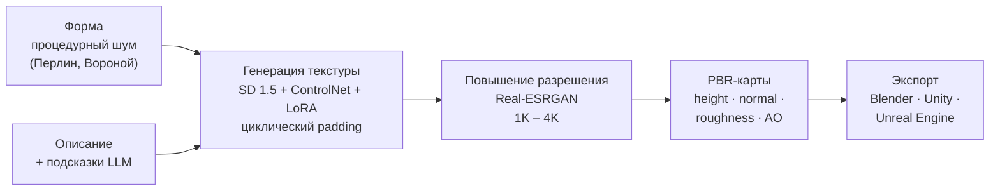
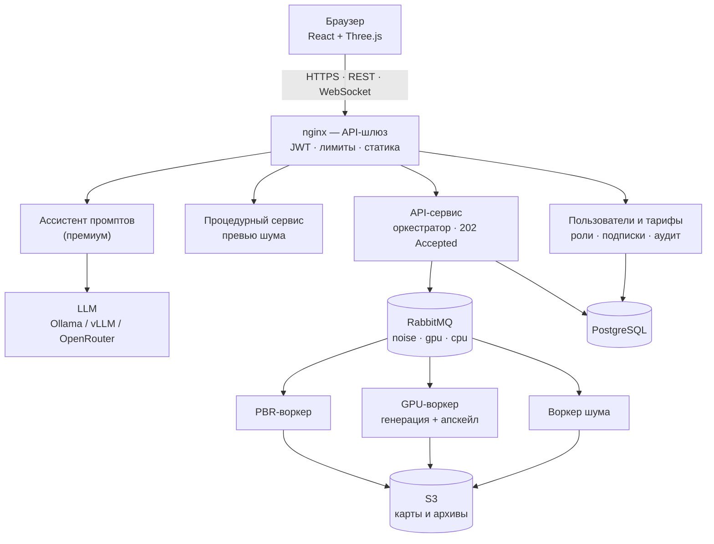
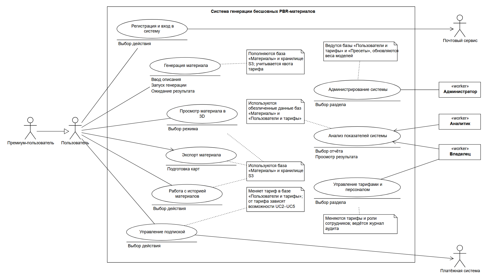

<div align="center">

# ML-Based 3D Material Texture Synthesis

**Генерация бесшовных PBR-материалов на основе процедурного шума и генеративных нейронных сетей**

Выпускная квалификационная работа · РГРТУ им. В. Ф. Уткина · 09.03.04 «Программная инженерия» · 2027


</div>

---

> Тема: «Разработка программного обеспечения для генерации бесшовных текстур материалов на основе процедурного шума с использованием генеративных нейронных сетей».
> Автор: Непрокин И. С., группа 3413.

## О проекте

Облачный сервис, который по описанию и параметрам формы создаёт **бесшовный набор PBR-карт** (albedo, normal, height, roughness, AO), готовый для Blender, Unity и Unreal Engine.

Идея — разделить ответственность: **процедурный шум задаёт форму** материала, **диффузионная модель — фактуру**, а собственный код доводит результат до бесшовных карт.



Бесшовность сохраняется на каждом этапе: периодический шум → циклический padding в UNet, ControlNet и VAE → wrap-паддинг при апскейле → wrap-фильтры при расчёте PBR-карт.

## Архитектура

Все сервисы асинхронные и масштабируются в ширину; система разворачивается в **Kubernetes** (предварительно Amazon EKS), для разработки — Docker Compose.



| Тариф | Бесплатный | Премиум |
|---|---|---|
| Разрешение | 1024² | 2048², 4096² |
| Шаги / варианты | 20 / 1 | 30–40 / до 4 |
| Референс-картинка, подсказки к промпту | — | ✓ |
| Хранение материалов | 7 дней | 90 дней |

Модель генерации **одна для всех тарифов**; дообучается только LoRA для SD 1.5. Персонал: **администратор** (обслуживание), **аналитик** (обезличенные показатели), **владелец** (тарифы, роли, финансы); все изменения персонала пишутся в журнал аудита.

Подробно — [02_Архитектура_системы](02_Архитектура_системы), журнал решений — [11_Решения_и_вопросы.md](02_Архитектура_системы/11_Решения_и_вопросы.md).

## UML-модель системы

Курс «Проектирование программных систем» моделирует эту же систему. **Модель одна на весь курс**: каждая работа дополняет проект StarUML предыдущей (форматы `.mdj` для StarUML 6 и `.uml` для StarUML 5.0).

| № | Работа | Состав | Статус |
|---|---|---|---|
| 1 | [Диаграмма прецедентов](04_Лабораторные_UML/ЛР1_Диаграмма_прецедентов) | 10 диаграмм, 7 акторов и работников, сценарии и потоки | ✅ |
| 2 | [Диаграмма деятельности](04_Лабораторные_UML/ЛР2_Диаграмма_деятельности) | 15 диаграмм, 35 деятельностей | ✅ |
| 3 | [Диаграмма автомата](04_Лабораторные_UML/ЛР3_Диаграмма_автомата) | 16 автоматов: сценарии акторов, прецеденты, жизненные циклы объектов | ✅ |
| 4 | [Диаграмма классов](04_Лабораторные_UML/ЛР4_Диаграмма_классов) | 56 классов (сущности, граничные, управляющие), 77 отношений, 16 диаграмм | ✅ |
| 5–8 | Последовательность, коммуникация, компоненты, размещение | — | ⏳ |

<p align="center">
  
  <br><sub>Основная диаграмма вариантов использования (ЛР1)</sub>
</p>

Модели не рисуются вручную: они собираются генераторами из [`_инструменты`](04_Лабораторные_UML/_инструменты), которые раскладывают элементы, автоматически проверяют наложения и пересечения линий и рисуют SVG/PNG. Скрипты с описанием моделей каждой работы и сборки отчётов хранятся локально; в репозитории — готовые проекты StarUML, рисунки, документирование и отчёты.

## Структура репозитория

```text
├── 00_Литература/            список источников (учебники кафедры в репозиторий не входят)
├── 01_Презентация_темы/      презентация темы ВКР (v3 — согласованная, v4 — актуальная)
├── 02_Архитектура_системы/   сервисы, Kubernetes, облако, LLM-провайдеры, решения
├── 03_Аналоги/               Meshy, Polycam, Scenario, Adobe Sampler, Unity и др.
├── 04_Лабораторные_UML/      ЛР0–ЛР8 и инструменты сборки моделей
│   └── _инструменты/         генераторы проектов StarUML, рисунки и проверка диаграмм
└── 05_Нейросетевые_модели/   SD 1.5, LoRA, ControlNet, IP-Adapter, Real-ESRGAN, LLM
```

## Как проверить диаграммы

Проекты StarUML открываются в StarUML 6 (`.mdj`) или StarUML 5.0 (`.uml`). Автоматическая проверка раскладки любой диаграммы из `.mdj` (Python 3.11+):

```bash
cd 04_Лабораторные_UML/_инструменты && python -I mdj_render.py --check ../ЛР4_Диаграмма_классов/01_Модель/ЛР4_Классы.mdj
```

## Источники

Все использованные материалы и ссылки — [00_Литература/Список_источников.md](00_Литература/Список_источников.md); источники по аналогам — [03_Аналоги/Источники.md](03_Аналоги/Источники.md).

---

<div align="center"><sub>РГРТУ им. В. Ф. Уткина · кафедра вычислительной и прикладной математики · 2026–2027</sub></div>
